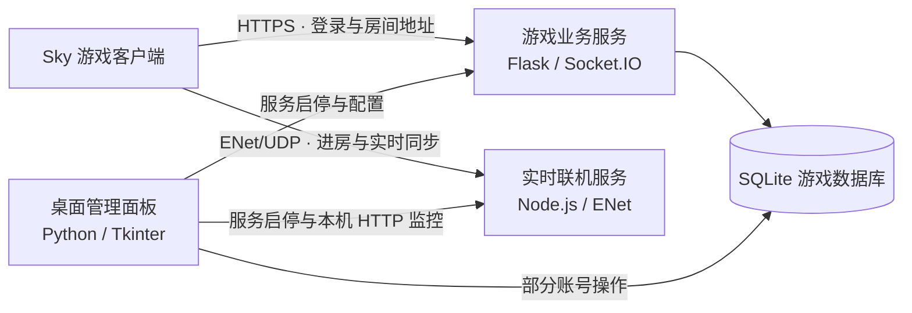

# LaServer

SkyLightAwaits 的游戏业务与实时联机服务端，包含 Python HTTP 服务、Node.js UDP 联机服务及桌面管理面板。

## 项目架构

游戏业务服务与实时联机服务可以独立启动。客户端先通过 HTTPS 登录、读取账号与好友数据并获取房间地址，再直接连接实时联机服务，完成进房、玩家同步和实时消息传输。



| 模块 | 入口 | 职责 |
| --- | --- | --- |
| 游戏业务服务 | [`sky_boot.py`](services/game-api/sky_boot.py) | 引导 [`index.py`](services/game-api/index.py) 初始化 Flask、Socket.IO 和数据库。业务层负责账号、好友、任务和管理接口，基础设施层负责数据访问、静态响应、监控与传输。 |
| 实时联机服务 | [`main.js`](services/realtime-server/src/main.js) | 启动房间服务和本机管理 HTTP。会话层维护房间与玩家状态，协议层处理版本兼容，传输层负责 ENet，监控层记录指标和数据包。 |
| 桌面管理面板 | [`admin_panel_client.py`](apps/admin/admin_panel_client.py) | 管理服务启停、配置、账号和接口响应，并通过联机服务的管理 HTTP 查看监控数据。部分账号操作直接访问 SQLite。 |
| 客户端适配工具 | [`tools/patches/`](tools/patches/) | 保存 APK 和二进制适配脚本，可独立于服务执行。 |

启动示例使用业务 HTTPS `8443/TCP`、联机 `25565/UDP` 和本机管理 HTTP `127.0.0.1:8080`。部署时，`config/room_config.json` 中下发给客户端的地址和端口应与客户端实际可达的 UDP 地址和端口一致。[启动与端口配置](docs/STARTUP.md)

## 项目结构

```text
LaServer/
├── apps/admin/                       桌面管理面板
├── services/
│   ├── game-api/                     游戏业务服务
│   │   ├── business/                 业务代码
│   │   │   ├── account/              账号与玩家接口
│   │   │   ├── service/              游戏业务接口
│   │   │   ├── admin/                管理接口
│   │   │   ├── starwatch/            统计与认证接口
│   │   │   └── helpers/              共享业务逻辑
│   │   ├── infrastructure/           技术基础设施
│   │   │   ├── database/             数据模型与迁移
│   │   │   ├── monitoring/           请求监控
│   │   │   ├── transport/            WebSocket 通信
│   │   │   ├── runtime/              热重载与错误处理
│   │   │   └── responses/            静态响应分流代码
│   │   ├── config/                   服务与游戏配置
│   │   ├── resources/                图片与静态响应 JSON
│   │   ├── var/                      数据、日志、证书和运行状态
│   │   ├── tools/                    配置维护脚本
│   │   └── paths.py                  统一路径定义
│   └── realtime-server/              ENet / UDP 实时联机服务
│       ├── src/                      协议、房间、传输与监控
│       ├── tests/                    手动协议回归脚本
│       ├── tools/                    历史抓包分析
│       └── docs/                     协议适配说明
├── tools/patches/                    客户端修补工具
├── docs/                            依赖和启动说明
├── pyproject.toml                   Python 项目声明
├── uv.lock                          Python 依赖锁文件
└── requirements.txt                 pip 兼容依赖清单
```

运行时使用的 `data/`、`logs/`、证书和本地配置不纳入版本控制。

完整依赖、安装方法和当前缺失模块见 [项目依赖文档](docs/DEPENDENCIES.md)。

## 环境要求

- Windows / Linux：`sky_boot.py` 在 Windows 上应用 WMI 绕过，在 Linux 上直接引导业务入口；Linux 完整运行验证仍待完成。
- Python：当前 uv 环境固定为 3.15.1（`.python-version`），项目范围为 `>=3.15,<3.16`。依赖声明在 `pyproject.toml`，精确版本由 `uv.lock` 锁定；已通过依赖导入和异步组件初始化检查，完整业务运行尚待验证。
- uv：管理 Python 虚拟环境与依赖。
- Node.js 20 或更新版本及 npm。

## 安装依赖

以下命令在项目根目录执行，uv 自动管理 `.venv`：

```powershell
uv sync --locked
uv pip check
npm --prefix services/realtime-server ci
```

`pyproject.toml` 声明 11 项 Python 直接依赖。添加依赖使用 `uv add <包名>`，按需更新使用 `uv lock --upgrade` 后执行 `uv sync`。`requirements.txt` 是兼容 pip 的生成文件，更新后用 `uv export --format requirements-txt --no-hashes --no-emit-project --output-file requirements.txt` 同步。Node.js 依赖仍通过 `package-lock.json` 和 npm 管理。

Tkinter/Tcl-Tk 和 SQLite 支持由 Python 安装提供，无须安装同名 pip 包。管理面板已包含游戏控制与接口响应管理模块，详见[依赖文档](docs/DEPENDENCIES.md#本地管理模块)。

## 本地配置

在项目根目录执行：

```powershell
Copy-Item services/game-api/config/server.example.json services/game-api/config/server.json
Copy-Item services/game-api/config/room_config.example.json services/game-api/config/room_config.json
```

按实际部署地址修改上述文件。管理面板默认定位本项目的两个服务目录。

在 `services/game-api/var/certs/` 准备 `fullchain.pem` 和 `privkey.pem`，或使用管理面板的证书配置功能。

既有实例的主数据库及状态位于 `services/game-api/var/data/instance/`；原独立数据库位于 `var/data/legacy/users.db`，两者应分别迁移。仓库不包含账号数据、运行状态或证书；仅克隆源码并不代表已完成运行环境部署。

## 启动

Windows / Linux 的独立服务环境配置、准备及启动脚本见 [跨平台启动说明](docs/STARTUP.md)。

以下命令均在项目根目录执行，先完成依赖安装、本地配置及数据准备。

HTTP 业务服务：

```powershell
uv run --locked python -u services/game-api/sky_boot.py
```

管理面板：

```powershell
uv run --locked python apps/admin/admin_panel_client.py
```

实时联机服务：

```powershell
npm --prefix services/realtime-server start
```

联机服务可通过 `ROOM_PORT`、`HTTP_PORT` 等环境变量配置，详见 `src/config/env.js`。与既有实例并行运行时使用独立端口。

## 检查与测试

在 `services/realtime-server/` 执行：

```powershell
npm run check
node tests/sky0134-regression.mjs
```

`npm run check` 仅检查入口语法。手动协议回归脚本当前有一条构建号限制断言与实现不一致，尚未修复。目录整理后已完成 Python 语法与路径静态检查；完整 HTTP 运行验证仍需安装依赖并使用隔离数据执行。

## 数据与安全

`.gitignore` 排除了备份、依赖目录、数据库、证书私钥、日志、抓包、本机配置，以及两份含敏感字段的认证响应样本。请勿提交生产数据或访问凭据。

HTTP 监控历史保存在 `services/game-api/var/data/monitor_exports/`；UDP 收发包历史保存在 `services/realtime-server/data/packets/`；各服务日志保存在各自的 `logs/`。

更多模块说明参见各服务目录的 README。

业务目录布局和路径约定见 [game-api 说明](services/game-api/README.md)。目录迁移后应重启进程，不能仅热重载旧进程。
